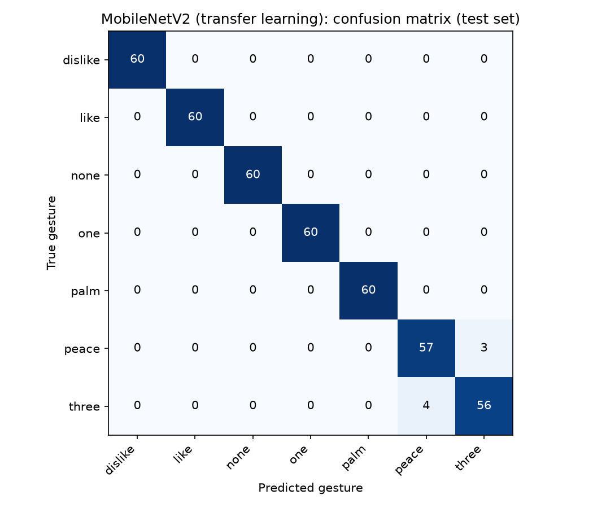

# AI-Based Gesture-Controlled Devices: prototype

Show a hand gesture to the camera and the system switches an LED light and an
axial fan on and off and sets the light's brightness and the fan's speed. A
MobileNetV2 CNN (transfer learning with TensorFlow/Keras) classifies the hand
inside a box drawn by OpenCV. On the Raspberry Pi 5 each device has a relay
for power and a MOSFET driven with PWM for its level. On a laptop everything
is simulated on screen.

```
Camera ──> OpenCV (mirror, crop hand box) ──> MobileNetV2 CNN (TFLite)
       ──> stabiliser (5-frame vote, 85% confidence) ──> action
       ──> light: GPIO17 relay (power) + GPIO12 PWM MOSFET (brightness)
       ──> fan:   GPIO27 relay (power) + GPIO18 PWM MOSFET (speed)
```

## Results

| Model | Test accuracy | Size | Inference (laptop CPU) |
|---|---|---|---|
| MobileNetV2, transfer learning (**deployed**) | 98.1 % (TFLite) | 2.54 MB | 11.7 ms |
| Own CNN from scratch | 100 % | 1.24 MB | 3.3 ms |

The test set is a whole recording session held out from training (420 images),
so the score measures generalisation to new lighting and backgrounds, not
memorised frames. The only confusions are between `peace` and `three`.



> The training photos are not included in this repo. Record your own with
> `collect_data.py` (see Part A3 below).

## Gestures

First pick a device, then control it. The selected device stays selected
until you pick the other one.

| Gesture | Hand shape | Action |
|---|---|---|
| `one` | index finger up | Select the LIGHT |
| `peace` | index + middle finger (V) | Select the FAN |
| `palm` | open hand, fingers together | Selected device ON / OFF (toggle) |
| `like` | thumbs up | Brighter / faster (one step) |
| `dislike` | thumbs down | Dimmer / slower (one step) |
| `three` | three fingers up | Everything OFF |
| `none` | empty box / background | nothing |

Brightness steps are 10, 25, 50, 75 and 100%; fan steps are 60, 80 and 100%
(`LIGHT_LEVELS` / `FAN_LEVELS` in `config.py`).

You can change gestures and actions in `config.py`.

## Files

| File | What it does |
|---|---|
| `config.py` | All settings: gestures, actions, box position, GPIO pins, thresholds |
| `collect_data.py` | Step 1: records your own gesture pictures into `dataset/` |
| `train.py` | Step 2: trains MobileNetV2, saves the model, plots and a TFLite file in `models/` |
| `detect.py` | Step 3: real-time recognition + appliance control |
| `test_hardware.py` | Checks the relay and fan wiring on the Pi, no camera needed |
| `camera.py`, `classifier.py`, `appliances.py` | Helpers used by the scripts above |

## Part A: on your laptop (collect, train, test)

Training is much faster on a laptop than on the Pi, so do Steps 1 to 3 here
first. A built-in webcam is fine.

### A1. Install Python

Install **Python 3.11 or 3.12** from <https://www.python.org/downloads/>.
On Windows, tick **"Add Python to PATH"** in the installer.

### A2. Set up the project

Open a terminal (Windows: *Command Prompt*) inside the `gesture_prototype`
folder, then:

```bash
python -m venv venv
venv\Scripts\activate          # Windows
source venv/bin/activate       # macOS / Linux
pip install -r requirements.txt
```

You should now see `(venv)` at the start of the line. Run the `activate`
line again every time you open a new terminal.

### A3. Record your dataset

```bash
python collect_data.py
```

For each gesture: put your hand in the green box, press **SPACE** and slowly
move your hand around (closer, further, slightly tilted, left and right
hand) until it reaches 200 pictures. For `none`, show the empty background
and move your arm through the frame. **Q** quits, **N** skips a gesture.

Tips that matter more than anything else for accuracy:

* Record **2 or 3 sessions** in different places and lighting (and ask a
  friend to do one). Running the script again adds pictures, it never deletes.
* Record at least one session **on the Pi camera** in the room where you will
  present. Copy those pictures into the same `dataset/` folders and retrain.
* Keep about the same number of pictures for every gesture.

To redo a single gesture: `python collect_data.py --gesture palm --count 150`

### A4. Train the model

```bash
python train.py
```

This takes about 5 to 20 minutes on a laptop CPU. When it finishes, the
`models/` folder holds:

* `gesture_model.tflite` (the small model for the Pi) and `labels.txt`
* `gesture_model.keras` (the full Keras model)
* `training_curves.png`, `confusion_matrix.png` and `report.txt` with test
  accuracy, per-gesture precision/recall, model size and inference time.
  The project target was 90 % test accuracy.

No laptop GPU? Google Colab works too: upload the folder (with `dataset/`),
then run `!pip install opencv-python` and `!python train.py`.

### A5. Try it live

```bash
python detect.py
```

The left side shows the camera, the predicted gesture and its confidence. The
right side shows the simulated light and fan; the selected one has a green
frame. Hold a gesture steady for about half a second to trigger it. Drop your
hand before repeating the same gesture (for example two thumbs-ups for two
brightness steps).

Keys **1 to 6** fake a gesture. This works even without a trained model, so
you can always demo the control side.

## Part B: on the Raspberry Pi 5

### B1. Prepare the Pi

1. Flash **Raspberry Pi OS (64-bit)** to the microSD card with Raspberry Pi
   Imager and boot the Pi with a screen, keyboard and mouse.
2. Connect the Camera Module 3 with the **Pi 5 camera cable** (22-pin end
   on the Pi, 15-pin end on the camera) with the Pi switched off.
3. Test the camera in a terminal: `rpicam-hello` should show a preview.

### B2. Install the software

```bash
sudo apt update
sudo apt install -y python3-picamera2 python3-opencv python3-gpiozero python3-lgpio
```

Copy the whole `gesture_prototype` folder (including `models/`) to the Pi,
for example on a USB stick, into `/home/<you>/gesture_prototype`. Then:

```bash
cd ~/gesture_prototype
python3 -m venv --system-site-packages venv
source venv/bin/activate
pip install -r requirements-pi.txt
```

`--system-site-packages` is important: it lets the venv use Picamera2 and
OpenCV installed by apt. If `ai-edge-litert` fails to install, run
`pip install tensorflow` instead.

### B3. Wire it up (power OFF while wiring)

Follow the pin table below (a wiring diagram can be added to `docs/`).

Pins (BCM numbers, physical pin in brackets):

| Part | GPIO |
|---|---|
| Relay IN1, light power | GPIO17 (11) |
| Relay IN2, fan power | GPIO27 (13) |
| Light MOSFET gate, brightness PWM | GPIO12 (32) |
| Fan MOSFET gate, speed PWM | GPIO18 (12) |
| Light status LEDs green / yellow / red | GPIO5 (29) / GPIO6 (31) / GPIO13 (33) |
| Fan status LEDs green / yellow / red | GPIO19 (35) / GPIO26 (37) / GPIO21 (40) |
| Relay VCC / JD-VCC / GND | 3.3 V (1) / 5 V (2) / GND (6) |
| Breadboard ground rail | GND (14) |

Remove the relay board's JD-VCC jumper so its inputs run on 3.3 V and its
coils on 5 V. Both 12 V devices run from the 12 V / 3 A adapter. Never connect
12 V to any Pi pin.

### B4. Test the wiring

```bash
python test_hardware.py
```

The light should switch on and step through every brightness, then the fan
through every speed. If a device is on when it should be off, change
`RELAY_ACTIVE_HIGH` in `config.py`. If the fan stalls at its lowest speed,
raise the first value of `FAN_LEVELS`; if it whines, try another
`FAN_PWM_FREQUENCY`. If the LEDs flicker, raise `LIGHT_PWM_FREQUENCY`.

### B5. Run the full system

```bash
python detect.py --hardware
```

Useful options:

* `--log` saves every frame's gesture, confidence, inference time and FPS to
  `logs/` as a CSV (good for your results section).
* `--headless` runs without a window (for example over SSH).
* `--camera webcam` uses a USB webcam instead of the Pi camera.

Press **Q** (or Ctrl+C) to stop. Everything is switched off on exit.

## Troubleshooting

| Problem | Fix |
|---|---|
| `Could not open webcam 0` | Close other apps using the camera, or try `--camera-index 1` |
| Pi camera not found | Check the ribbon cable direction and run `rpicam-hello` |
| `No module named picamera2` on the Pi | The venv was made without `--system-site-packages`; delete `venv` and redo B2 |
| Gesture flickers or is often wrong | Record more varied pictures (Part A3 tips) and retrain; keep the hand inside the box |
| Reacts too slowly / too eagerly | Change `CONFIDENCE_THRESHOLD`, `SMOOTHING_FRAMES` or `ACTION_COOLDOWN_S` in `config.py` |
| `cannot connect to X server` / no window | Run on the Pi desktop, or add `--headless` |
| Very high test accuracy but poor live results | All pictures came from one session; add sessions with other lighting/backgrounds |

## Ideas if you have time left

* Use a second relay channel for a real TV or another appliance.
* Crop the hand automatically with MediaPipe Hands instead of a fixed box.
* Fully integer-quantise the TFLite model and compare speed and accuracy.

## Helper scripts (`scripts/`)

PowerShell/Bash helpers for working with the Pi from a Windows laptop: push code
or a new model over SSH, stream the laptop webcam to the Pi, fix Wi-Fi, and keep
the Pi's clock right on networks that block NTP. They assume the Pi is reachable
as `pi@raspberrypi.local`; change that to your own Pi's user and hostname.
